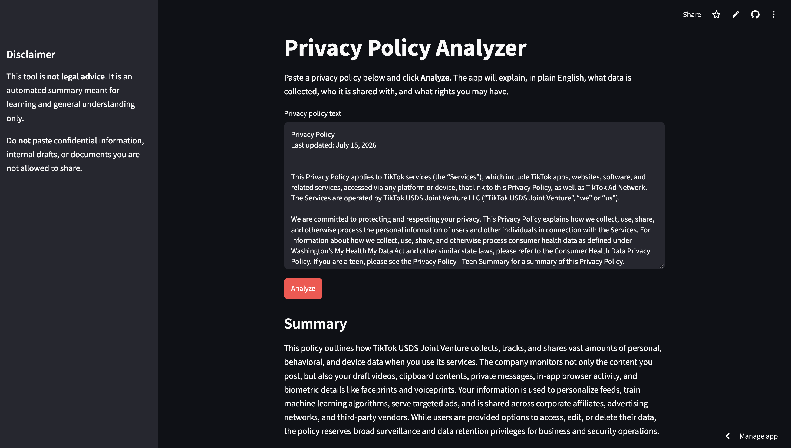

# Privacy Policy Analyzer

An AI tool that reads a privacy policy and explains it in plain English — what data is collected, who it's shared with, what rights you have, and where the policy raises red flags under GDPR and CCPA.

**Live demo:** [Try the app](https://privacy-policy-analyzer-r84x76qkhh4mfvrd6gvzrx.streamlit.app/)



---

## Why I built this

Almost nobody reads privacy policies. They're long, vague, and written by lawyers for lawyers. But they decide what happens to our data: whether it's sold, how long it's kept, and whether we can delete it.

I'm studying Cybersecurity & Global Policy at Indiana University and plan to pursue a legal career. I wanted to build something at the intersection of law and technology: a tool that makes the legal fine print readable for everyday users.

## What it does

Paste the full text of a privacy policy and the app returns:

- **Summary** — what the policy means for you in 3–5 sentences
- **Data Collected** — the types of personal data gathered
- **Sharing & Selling** — who receives your data and whether it's sold
- **Your Rights** — access, deletion, opt-out, correction
- **Red Flags** — concerning clauses rated Low / Medium / High risk
- **GDPR & CCPA Notes** — where the policy appears to meet or fall short of major privacy laws

## Findings: TikTok's privacy policy

Running TikTok's privacy policy through the analyzer surfaced several things most users would never notice:

- **Biometric identifiers:** the policy mentions collecting "faceprints and voiceprints." Biometric data is among the most heavily regulated categories in privacy law.
- **Keystroke patterns and clipboard contents:** the app can collect *how* you type and what's on your clipboard, not just what you post.
- **Inferred information:** the policy says TikTok may infer details like your age, gender, and interests from your activity.


I spot-checked each of these findings against the original policy text to confirm the AI didn't invent them.

## A bug I found and fixed: AI hallucination

During testing, I typed only the words "TikTok privacy policy" instead of pasting the actual policy. The app still produced a detailed analysis, written entirely from the AI model's general knowledge rather than from any document.

For a legal tool, that's the most dangerous kind of error: a user could trust an analysis that isn't based on the real text. I fixed it in two layers:

1. **Input validation in the code:** the app refuses to call the AI if the text is under 500 characters.
2. **Prompt rules:** the AI is instructed to refuse any input that isn't actual policy text and to never use outside knowledge about a company.

Now the app asks for the full policy text instead of guessing.

## Security

- **The API key is never in the code.** Locally it's stored in a `.env` file excluded by `.gitignore`. In production it's stored in Streamlit's encrypted secrets.
- **Users are warned not to paste confidential information**, because text is sent to a third-party AI provider for processing.
- **Credential hygiene:** during development I accidentally exposed a GitHub access token in my terminal, so I revoked it and generated a new one.

## How it works

| Part | Technology |
|---|---|
| Interface | [Streamlit](https://streamlit.io) (Python) |
| AI model | Google Gemini via the `google-genai` library |
| Legal analysis instructions | `prompt.txt`, kept separate from the code so the analysis rules can be refined without touching the app logic |
| Hosting | Streamlit Community Cloud |

## Run it locally

```bash
git clone https://github.com/ibynazer-ctrl/privacy-policy-analyzer.git
cd privacy-policy-analyzer
python3 -m venv venv
source venv/bin/activate
pip install -r requirements.txt
```

Create a `.env` file with your own [Gemini API key](https://aistudio.google.com):

```
GEMINI_API_KEY=your-key-here
```

Then run:

```bash
streamlit run app.py
```

## Limitations

- **This is not legal advice.** It's an automated analysis and can make mistakes.
- The AI may miss clauses or misjudge risk levels. Always check important findings against the original policy.
- Very long policies (over 100,000 characters) must be shortened before analysis.
- On the free tier, text sent to the AI provider may be used to improve its models, which is why users should only paste public documents.

## Future improvements

- Paste a URL instead of text, and the app fetches the policy automatically
- A 0–100 privacy score
- Side-by-side comparison of two companies' policies
- Download the analysis as a PDF

## Author

**Ibrahim Nazer** — Cybersecurity & Global Policy, Indiana University Bloomington
